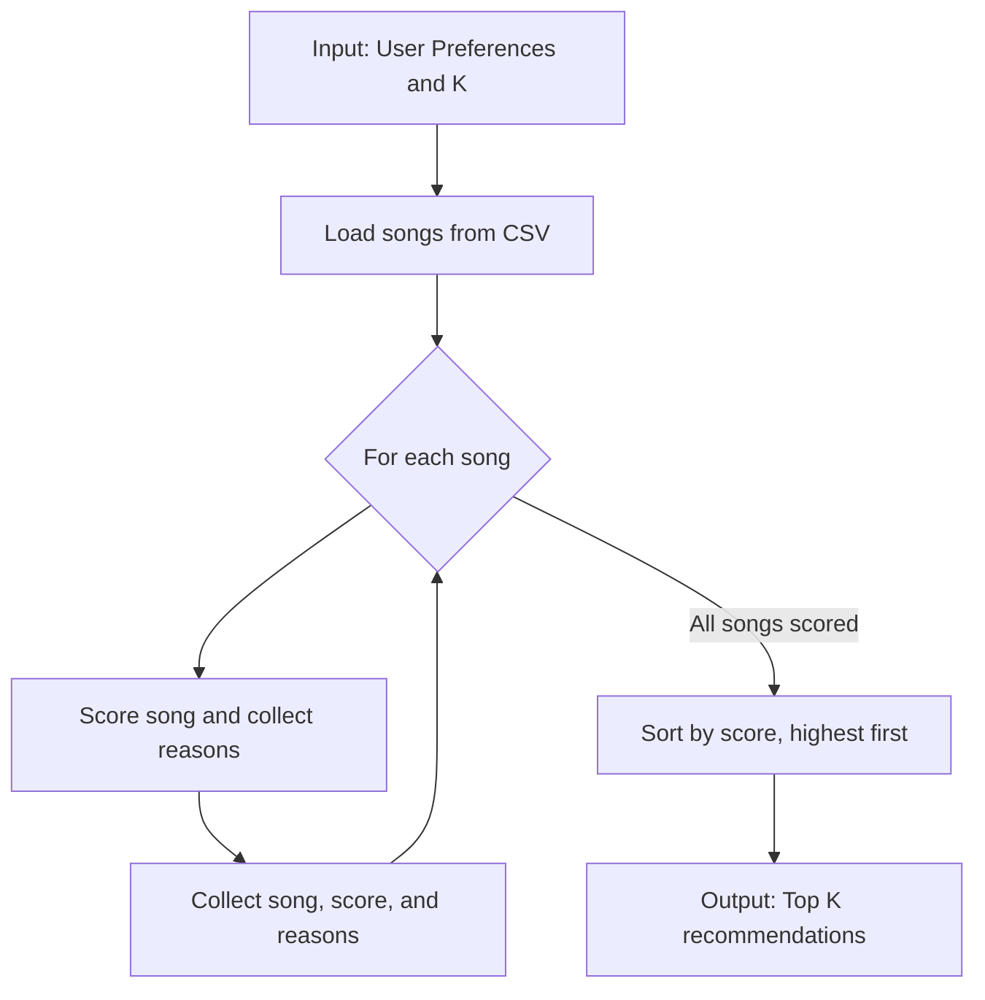

# 🎵 Music Recommender Simulation

## Project Summary

In this project you will build and explain a small music recommender system.

Your goal is to:

- Represent songs and a user "taste profile" as data
- Design a scoring rule that turns that data into recommendations
- Evaluate what your system gets right and wrong
- Reflect on how this mirrors real world AI recommenders

Replace this paragraph with your own summary of what your version does.

---

## How The System Works

Explain your design in plain language.

Some prompts to answer:

- What features does each `Song` use in your system
  - For example: genre, mood, energy, tempo
- What information does your `UserProfile` store
- How does your `Recommender` compute a score for each song
- How do you choose which songs to recommend

You can include a simple diagram or bullet list if helpful.

The project needs both a Scoring Rule and a Ranking Rule because they solve two different problems in a recommendation system. One evaluates a single item, and the other decides which items should appear first when there are many candidates.

🎯 Why a Scoring Rule is needed

A Scoring Rule answers the question: “How good is this one song for this user?”

It takes the features of a single song — genre match, mood match, energy closeness, popularity, recency, etc. — and converts them into one numeric score.

Examples:
- 0.87 = very good match
- 0.42 = weak match
- 0.12 = probably irrelevant

A scoring rule is local: it only looks at one item at a time.

The Scoring Rule is needed because:
- We must quantify how well each song fits the user.
- We need a consistent way to compare items.
- We need a way to combine multiple features (genre + mood + energy + etc.) into one number.

Without a scoring rule, we have no way to evaluate individual songs.

📈 Why a Ranking Rule is needed

A Ranking Rule answers a different question: “Given 500 scored songs, which 20 should I show first?”

Even if every song has a score, we still need a strategy for ordering them.
Ranking is global: it considers the whole list.

Why ranking matters:
- We may want to diversify results (not 20 songs from the same artist).
- We may want to boost freshness (new releases get a slight bump).
- We may want to avoid repetition (don’t show 5 songs with identical mood).
- We may want to balance long‑term taste vs. session context.
- We may want to break ties when many songs have similar scores.

Ranking rules often include:
- Sorting by score
- Re-ranking for diversity
- Re-ranking for novelty
- Re-ranking for business logic (e.g., promote new artists)

Without a ranking rule, the system would just dump a raw list of scores — not a curated, user-friendly playlist.

🧠 The Key Insight

Scoring = evaluating items individually.  

Ranking = deciding the best order for a group of items.

We need both because:
- A scoring rule alone cannot produce a good playlist.
- A ranking rule alone cannot evaluate items.

Together, they create a real recommendation pipeline.

## The specific features the Song and UserProfile objects will use in the simulation

Song
- id — unique identifier
- title — display name
- artist — display metadata; not a core similarity feature
- genre — categorical feature
- mood — categorical feature
- energy — numeric, 0–1
- tempo_bpm — numeric, BPM
- valence — numeric, 0–1
- danceability — numeric, 0–1
- acousticness — numeric, 0–1

UserProfile
- preferred_genres — genres the user likes, with preference scores
- preferred_moods — moods the user likes, with preference scores
- energy_preference — preferred energy level, 0–1
- tempo_preference_bpm — preferred tempo
- valence_preference — preferred valence, 0–1
- danceability_preference — preferred danceability, 0–1
- acousticness_preference — preferred acousticness, 0–1

The recommender can compare a song’s genre and mood against the profile’s categorical preferences, and its numeric values against the profile’s preferred values. id, title, and artist identify or display songs; they need not affect similarity in the initial simulation.

---

## Getting Started

### Setup

1. Create a virtual environment (optional but recommended):

   ```bash
   python -m venv .venv
   source .venv/bin/activate      # Mac or Linux
   .venv\Scripts\activate         # Windows

2. Install dependencies

```bash
pip install -r requirements.txt
```

3. Run the app:

```bash
python -m src.main
```

### Running Tests

Run the starter tests with:

```bash
pytest
```

You can add more tests in `tests/test_recommender.py`.

---

## Sample Recommendation Output

Paste a sample of your recommender's output here as a text block so a reader can see what it produces:

```
# e.g.:
# User profile: genre=indie, mood=chill, energy=low
# Recommendations:
#   1. ...
#   2. ...
#   3. ...
```

```python
taste_profile_1 = {
    "favorite_genre": "lofi",
    "favorite_mood": "chill",
    "target_energy": 0.40,
    "target_tempo_bpm": 80,
    "target_valence": 0.60,
    "target_danceability": 0.60,
    "target_acousticness": 0.80,
}
```

```python
taste_profile_2 = {
    "preferred_genres": {
        "lofi": 1.0,
        "ambient": 0.8,
        "jazz": 0.6,
        "rock": 0.2,
    },
    "preferred_moods": {
        "chill": 1.0,
        "focused": 0.8,
        "relaxed": 0.7,
        "intense": 0.1,
    },
    "energy_preference": 0.40,
    "tempo_preference_bpm": 80,
    "valence_preference": 0.60,
    "danceability_preference": 0.60,
    "acousticness_preference": 0.80,
}
```

## Scoring Logic Design

A balanced starting point is to give Genre and Mood equal weight, then divide the remaining points across the five numeric features:

| Feature |	Weight |
| ------- | ------ |
| Genre match |	20 points |
| Mood match |	20 points |
| Energy closeness |	12 points |
| Tempo closeness |	12 points |
| Valence closeness |	12 points |
| Danceability closeness |	12 points |
| Acousticness closeness |	12 points |
| Total |	100 points |

Use the profile’s preference values (0–1) for genre and mood matches. For numeric features, calculate closeness as 1 - normalized_difference, where 1 means an exact match and 0 means the values are far apart. For 0–1 features, the normalized difference is simply the absolute difference; for tempo, divide by a chosen BPM range, such as 180, and cap the result at 1.

For example, a chill lofi song would score strongly for a profile favoring lofi and chill with low energy and tempo. Intense rock would score lower on genre and mood—and likely on those numeric preferences too. These weights are a reasonable baseline; adjust them after checking whether recommendations reflect the intended taste.

## Quick Map of Data Flow



In short: preferences and CSV → score every song → rank by score → return top K.

**Screenshot or video** *(optional)*: <!-- Insert a screenshot or demo video link here -->

---

## Experiments You Tried

Use this section to document the experiments you ran. For example:

- What happened when you changed the weight on genre from 2.0 to 0.5
- What happened when you added tempo or valence to the score
- How did your system behave for different types of users

---

## Limitations and Risks

Summarize some limitations of your recommender.

Examples:

- It only works on a tiny catalog
- It does not understand lyrics or language
- It might over favor one genre or mood

You will go deeper on this in your model card.

---

## Reflection

Read and complete `model_card.md`:

[**Model Card**](model_card.md)

Write 1 to 2 paragraphs here about what you learned:

- about how recommenders turn data into predictions
- about where bias or unfairness could show up in systems like this
